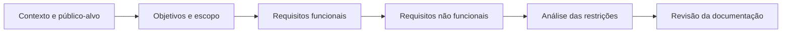

# Engenharia de Software 2 — Documentação de sistemas

 

## 🎯 Missão documental · Da necessidade à especificação

> **Objetivo:** interpretar requisitos, identificar lacunas e demonstrar rastreabilidade documental. Aqui, gamificação significa **marcos claros e validação por evidências**, sem transformar requisitos ainda não implementados em funcionalidades prontas.

| Etapa | Missão | Evidência | XP didático |
|---|---|---|--:|
| 01 · Descoberta | Identificar público-alvo, escopo e objetivos | [Documento bancário](01-Modelo%20de%20Documenta%C3%A7%C3%A3o%20de%20Sistema.docx) | 20 |
| 02 · Requisitos | Localizar RF-01 a RF-05 no caso de receitas | [Documento de receitas](01-Modelo%20de%20Documenta%C3%A7%C3%A3o%20de%20Sistema_2.docx) | 25 |
| 03 · Qualidade | Distinguir RNFR de RNFS nos dois modelos | [Arquivos Word](#documentos) | 25 |
| 04 · Revisão | Identificar campos pendentes e inconsistências de título | [Pontos de atenção](#estrutura-dos-documentos) | 30 |

- [ ] Diferenciar requisitos funcionais e não funcionais usando exemplos dos documentos.
- [ ] Elaborar uma matriz ligando requisitos ao problema que atendem.
- [ ] Marcar os campos de modelo ainda sem preenchimento.
- [ ] Confirmar que se trata de **especificação**, não de dois aplicativos executáveis.

<strong>🏅 Critérios de conquista</strong>

| Marco | Evidência esperada |
|---|---|
| 🥉 Leitor de requisitos | Identificadores RF localizados corretamente |
| 🥈 Analista de qualidade | RNFR e RNFS distinguidos com exemplos |
| 🥇 Revisor técnico | Lacunas de preenchimento e inconsistências apontadas |
| 💎 Arquiteto documental | Matriz de rastreabilidade produzida e revisada |

**Pontuação simbólica:** a verificação é feita por você; não há emissão de certificado nem contagem automática.

---

Repositório com dois documentos Word de levantamento e especificação de requisitos. Os arquivos apresentam o modelo de documentação e as descrições de requisitos preenchidas para dois temas: aplicativo bancário e cadastro de receitas.

## Documentos

| Arquivo | Conteúdo das seções de requisitos |
|---|---|
| [01-Modelo de Documentação de Sistema.docx](01-Modelo%20de%20Documenta%C3%A7%C3%A3o%20de%20Sistema.docx) | Cadastro de conta, acesso, chave Pix, pagamento e compartilhamento de comprovante. |
| [01-Modelo de Documentação de Sistema_2.docx](01-Modelo%20de%20Documenta%C3%A7%C3%A3o%20de%20Sistema_2.docx) | Cadastro, listagem, busca, edição e exclusão de receitas. |

## Aplicativo bancário

O primeiro documento descreve os seguintes requisitos funcionais:

| Identificador | Requisito | Descrição resumida |
|---|---|---|
| RF-01 | Cadastrar conta | Informar nome completo, CPF, telefone e e-mail, além de criar uma senha com pelo menos dez caracteres, incluindo letras maiúsculas e minúsculas, números e um caractere especial. |
| RF-02 | Acessar a conta | Entrar com CPF e senha e aceitar os termos de acesso ao aplicativo. |
| RF-03 | Adicionar chave Pix | Cadastrar uma chave para receber pagamentos por Pix. |
| RF-04 | Escolher a forma de pagamento | Pagar por Pix, débito ou crédito em até cinco parcelas sem juros. |
| RF-05 | Compartilhar pagamento | Compartilhar o comprovante de uma conta paga. |

As tabelas de requisitos não funcionais relacionados incluem criptografia, segurança do cadastro, conformidade com a LGPD, conexão com a internet, redefinição de senha após cinco tentativas de acesso e compartilhamento de comprovante em PDF.

A seção de requisitos não funcionais sistêmicos registra resposta rápida ao usuário, uso do sistema operacional Windows e conexão com a internet.

## Cadastro de receitas

As seções preenchidas do segundo documento descrevem:

| Identificador | Requisito | Descrição resumida |
|---|---|---|
| RF-01 | Cadastrar receita | Informar título, ingredientes, modo de preparo e tempo estimado, com categorização da receita. |
| RF-02 | Listar receitas | Exibir as receitas em lista ou grade, com miniatura, título e tempo de preparo; ordená-las da mais recente para a mais antiga e permitir a consulta aos detalhes. |
| RF-03 | Buscar e filtrar | Buscar pelo título e filtrar por categoria, com atualização dos resultados durante a digitação. |
| RF-04 | Editar dados | Abrir o formulário com os dados atuais, confirmar as alterações e permitir substituir ou remover a imagem. |
| RF-05 | Excluir receita | Solicitar confirmação antes da exclusão e retornar à listagem atualizada. |

Os requisitos não funcionais sistêmicos desse documento tratam de:

- Interface minimalista e de alto contraste, com preto, branco e destaques em roxo.
- Armazenamento local para cadastrar e consultar receitas sem conexão com a internet.
- Carregamento da listagem e dos detalhes de uma receita em menos de dois segundos.
- Desenvolvimento para Android e iOS com uma única base de código.
- Compressão das fotos antes do armazenamento no dispositivo.

Esses itens são requisitos descritos nos documentos. O repositório não contém o código de implementação dos aplicativos.

## Estrutura dos documentos

Os dois arquivos usam seções para descrição do cliente e do público-alvo, objetivos, envolvidos no projeto, viabilidade, estimativas, restrições, escopo, levantamento e especificação dos requisitos.

Os modelos ainda contêm campos vazios, exemplos e instruções de preenchimento. Os campos de RF-06 a RF-08 permanecem com texto orientativo. No documento `_2`, a capa mantém o título “Aplicativo Bancário”, embora os requisitos preenchidos tratem de receitas.

## Como consultar

Use os links da tabela de documentos para abrir ou baixar cada arquivo `.docx`. Para visualizar as tabelas e a formatação, abra o arquivo em um editor compatível com esse formato.

Dentro dos documentos, os identificadores `RF`, `RNFR` e `RNFS` permitem localizar, respectivamente, os requisitos funcionais, os requisitos não funcionais relacionados e os requisitos não funcionais sistêmicos.

---

## Visão do processo de requisitos

## Matriz de rastreabilidade documental

| Categoria | Sistema bancário | Cadastro de receitas |
|---|---|---|
| Funcionalidades principais | Conta, autenticação, Pix, pagamentos, comprovante | Criar, listar, pesquisar, editar, remover |
| Segurança / qualidade | Criptografia, LGPD, acesso e senha | Interface, armazenamento local, desempenho |
| Entregável no repositório | [Modelo bancário](01-Modelo%20de%20Documenta%C3%A7%C3%A3o%20de%20Sistema.docx) | [Modelo de receitas](01-Modelo%20de%20Documenta%C3%A7%C3%A3o%20de%20Sistema_2.docx) |
| Código-fonte de aplicativo | Não incluído | Não incluído |

## Como estudar e reutilizar o material

1. Abra um dos documentos Word acima em um editor compatível.
2. Identifique **RF** (funcionais), **RNFR** (não funcionais relacionados) e **RNFS** (não funcionais sistêmicos).
3. Relacione cada requisito ao problema de negócio, à entrada esperada e ao comportamento descrito.
4. Antes de reutilizar como modelo, revise os campos ainda orientativos e o título de capa indicado nas observações.

### Referências técnicas úteis

- [ISO/IEC/IEEE 29148 — Engenharia de requisitos (visão do padrão)](https://www.iso.org/standard/72089.html)
- [Guia do GitHub para documentação Markdown](https://docs.github.com/pt/get-started/writing-on-github)

> **Escopo:** repositório de **documentação e estudo**, não uma aplicação implementada. Os requisitos representam especificações, não recursos disponíveis para execução.
